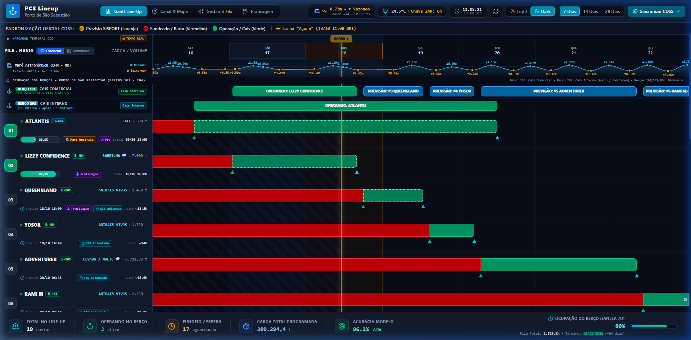
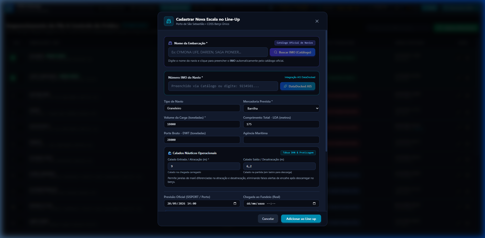
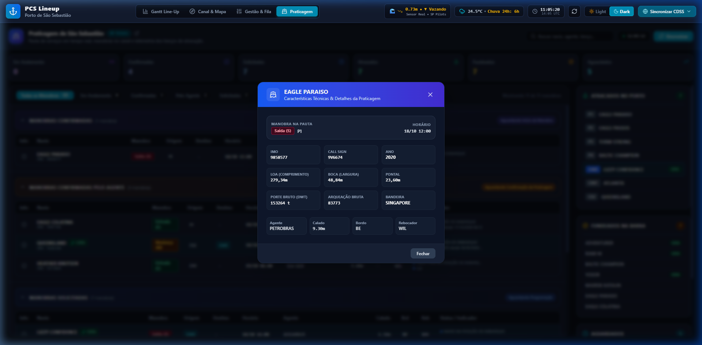
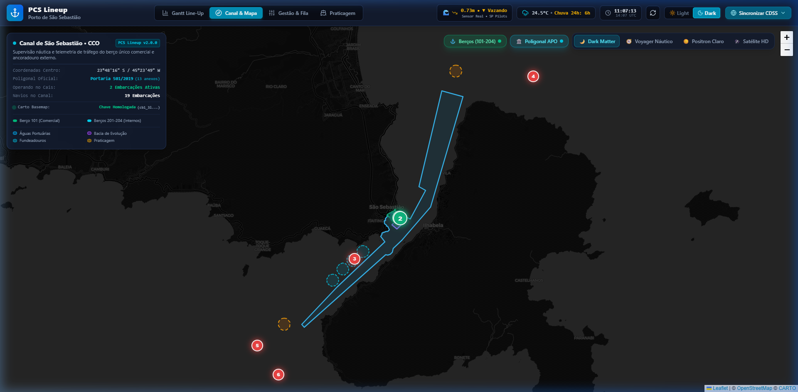
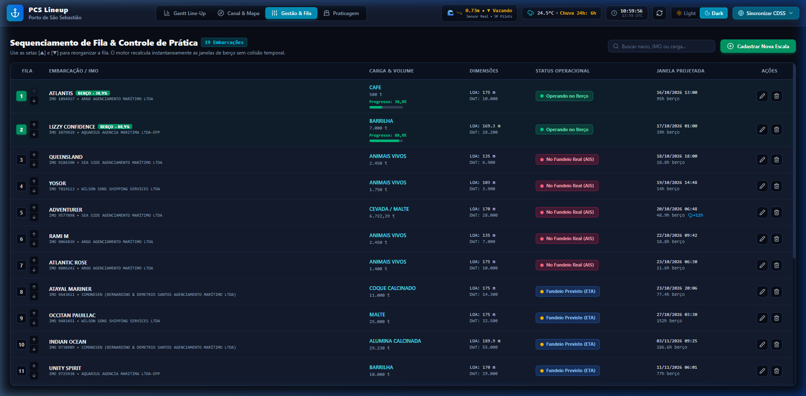
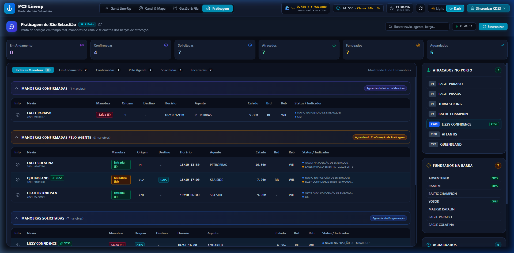

# PCS Lineup — Manual de Instruções do Usuário

> **Sistema Operacional do Centro de Controle Operacional (CCO)**  
> **Companhia Docas de São Sebastião (CDSS)**  
> Versão: 2.0.0 · Última atualização: 2026-10-18 · Gerado com base na interface operacional ativa.

---

## Sumário
1. [Visão Geral & Objetivo](#1-visão-geral--objetivo)
2. [Acesso ao Sistema](#2-acesso-ao-sistema)
3. [Conhecendo a Interface Operacional (Cockpit CCO)](#3-conhecendo-a-interface-operacional-cockpit-cco)
4. [Painel Gantt Line-Up & Gestão de Berços](#4-painel-gantt-line-up--gestão-de-berços)
5. [Cadastro e Edição de Escalas (Nova Escala)](#5-cadastro-e-edição-de-escalas-nova-escala)
6. [Ficha Técnica & Prontuário Náutico da Embarcação](#6-ficha-técnica--prontuário-náutico-da-embarcação)
7. [Canal & Cartografia Náutica](#7-canal--cartografia-náutica)
8. [Gestão da Fila & Sequenciamento de Atracação](#8-gestão-da-fila--sequenciamento-de-atracação)
9. [Pauta de Serviços da Praticagem (SP Pilots)](#9-pauta-de-serviços-da-praticagem-sp-pilots)
10. [Configurações de Sincronização do SISPORT](#10-configurações-de-sincronização-do-sisport)
11. [Guia de Erros Comuns & Resolução de Problemas](#11-guia-de-erros-comuns--resolução-de-problemas)
12. [Glossário Náutico & Portuário](#12-glossário-náutico--portuário)

---

## 1. Visão Geral & Objetivo

O **PCS Lineup** é a ferramenta central de visualização e planejamento do **Centro de Controle Operacional (CCO)** do Porto de São Sebastião. Desenvolvido para operadores, despachantes portuários, fiscais de atracação e gestores da autoridade portuária (CDSS), o sistema unifica em uma tela única de alta densidade:

- **Programação Visual de Berços:** Linha do tempo gráfica (Gantt) mostrando quando cada navio irá atracar, operar e desatracar.
- **Previsões Hidrodinâmicas e Meteorológicas:** Integração em tempo real com a tábua de marés da Marinha do Brasil (DHN), telemetria maregráfica ao vivo da Praticagem e alertas de paralisação por chuva para cargas sensíveis (como Trigo, Malte e Barrilha).
- **Segurança da Navegação (UKC):** Cálculo automático da **Folga Abaixo da Quilha** (espaço de água seguro entre o fundo do navio e o leito marítimo) na atracação e desatracação.
- **Rastreamento e Telemetria Satelital (AIS):** Posição geográfica em tempo real dos navios ao longo do Canal de São Sebastião.
- **Integração com Praticagem e SISPORT:** Recepção automática da pauta de manobras dos práticos e sincronização periódica com a programação comercial oficial do porto.

---

## 2. Acesso ao Sistema

### Como Abrir a Aplicação
O sistema funciona diretamente no navegador web de sua estação de trabalho (Google Chrome, Microsoft Edge ou Firefox recomendados), sem necessidade de instalação de programas locais:

1. Abra o navegador e digite o endereço institucional fornecido pelo suporte de TI:
   - **Ambiente de Operação Local:** `http://localhost:5173` ou `http://localhost:3000`
   - **Ambiente Corporativo / Produção:** `http://<ip-do-servidor-ou-dominio-cdss>:3000`
2. Pressione **Enter**. A tela principal será carregada imediatamente.

> ℹ️ **Autenticação:** O sistema opera na rede interna privada ou VPN do Porto de São Sebastião. Não é necessário digitar usuário e senha individuais para visualização do line-up; todos os operadores da rede autorizada têm acesso direto ao painel.

---

## 3. Conhecendo a Interface Operacional (Cockpit CCO)

A tela principal é dividida em quatro zonas estratégicas planejadas para monitoramento contínuo:

```
┌────────────────────────────────────────────────────────────────────────────────────────┐
│ [ZONA 1: BARRA SUPERIOR (HEADER)] - Indicadores, Clima, Telemetria de Maré e Sincronização │
├────────────────────────────────────────────────────────────────────────────────────────┤
│ [ZONA 2: ABAS DE NAVEGAÇÃO] - Gantt Line-Up | Gestão & Fila | Canal & Mapa | Praticagem │
├────────────────────────────────────────────────────────────────────────────────────────┤
│ [ZONA 3: ÁREA PRINCIPAL DE TRABALHO] - Exibição da visualização selecionada            │
├────────────────────────────────────────────────────────────────────────────────────────┤
│ [ZONA 4: BARRA DE STATUS INFERIOR] - Resumo de navios, volume e acurácia do modelo     │
└────────────────────────────────────────────────────────────────────────────────────────┘
```

### Controles Rápidos da Barra Superior

- **Logo CDSS & Título:** Exibe a versão ativa do sistema (v2.0.0).
- **Widget de Telemetria de Maré:** Exibe o nível atual da água em metros (ex: `1.28m`), se a maré está **Subindo** ou **Descendo** e a fonte dos dados (**SP Pilots** ou **DHN**).
- **Widget Meteorológico:** Exibe temperatura atual e previsão de precipitação nas próximas 24 horas.
- **Botão "Sincronizar SISPORT":** Força a atualização manual imediata com a programação de navios do portal oficial.
- **Botão "+ Nova Escala":** Abre o formulário para cadastro manual de um novo navio na fila.
- **Botão de Alternância de Tema (Sol/Lua):** Alterna instantaneamente entre o modo escuro (**Dark Mode**) e o modo claro (**Light Mode**).

---

## 4. Painel Gantt Line-Up & Gestão de Berços

O **Gantt Line-Up** é a tela inicial padrão e o coração do planejamento diário. Ele organiza a ocupação do cais em faixas horizontais de tempo.



### 4.1. Recursos da Linha do Tempo

1. **Linha Dourada/Vermelha "AGORA":**  
   Um traço vertical que se move em tempo real indicando o momento exato presente. Tudo à esquerda da linha é histórico ou operação corrente; tudo à direita representa projeções futuras calculadas pelo sistema.
2. **Gráfico Integrado de Maré da DHN (Mini-Curva no Topo):**  
   Uma onda contínua azulada exibida acima da régua de datas, sinalizando os horários exatos de **Preamar** (maré alta) e **Baixa-mar** (maré baixa) com suas alturas em metros.
3. **Fitas de Ocupação dos Berços:**
   - **Berço 101 (Cais Comercial):** Berço principal para granéis sólidos (Trigo, Malte, Barrilha) e carga geral. Aceita 1 navio comercial por vez, aplicando a regra de **2 horas de intervalo de manobra** entre saídas e chegadas.
   - **Berços 201 a 204 (Cais Interno):** Destinados a embarcações de apoio marítimo, rebocadores e cabotagem.
4. **Modos de Exibição (Essencial vs. Detalhado):**  
   No canto superior direito do Gantt, clique para alternar:
   - **Modo Essencial:** Apresenta barras de navios com altura compacta (2 linhas limpas), ideal para telões de vigilância do CCO.
   - **Modo Detalhado:** Exibe dados náuticos completos (calado de entrada, calado de saída, tonelagem e mercadoria) dentro de cada bloco.
5. **Seletor de Horizonte de Tempo (7D / 14D / 28D):**  
   Permite expandir o alcance da visão para **7 dias**, **14 dias** (duas semanas) ou **28 dias** (um mês).

### 4.2. Entendendo as Cores dos Navios no Gantt

| Cor da Barra | Significado Operacional | O que significa na prática |
|---|---|---|
| **Verde** | **Operando Real** | O navio está fisicamente atracado no berço, com operação de descarga ou carregamento em andamento. |
| **Azul** | **Previsão de Atracação** | Projeção calculada pelo sistema para atracação futura assim que o berço for desocupado. |
| **Cinza** | **Pronto para Atracar** | O navio já está na barra e recebeu **Livre Prática**, aguardando apenas vaga física no cais. |
| **Vermelho** | **Fundeado Aguardando** | O navio entrou na barra e está fundeado, porém ainda aguarda inspeção ou liberação sanitária/aduaneira. |
| **Laranja** | **Previsto em Viagem (ETA)** | O navio ainda está em alto-mar navegando rumo a São Sebastião; posição estimada via transponder AIS. |

---

## 5. Cadastro e Edição de Escalas (Nova Escala)

**Para que serve:** Cadastrar uma nova programação de navio que não conste no SISPORT ou antecipar o agendamento de uma viagem.



### Passo a Passo para Inserir uma Escala:

1. No cabeçalho da página ou na aba **Gestão & Fila**, clique no botão azul **"+ Nova Escala"** (ou **"Cadastrar Nova Escala"**).
2. O formulário flutuante será aberto. Preencha os campos obrigatórios e complementares:

| Campo | Obrigatório? | O que preencher | Exemplo |
|---|:---:|---|---|
| **Nome da Embarcação** | **Sim** | Nome oficial do navio. O sistema sugere navios do catálogo automaticamente ao digitar. | `PAN DAWN` |
| **Número IMO** | Não | Código naval único de 7 dígitos. Se deixar em branco, o sistema busca no catálogo de 16.200 navios. | `9642514` |
| **Mercadoria** | **Sim** | Tipo de carga a movimentar. Define a produtividade diária e a sensibilidade à chuva. | `Trigo a Granel` |
| **Volume (t)** | **Sim** | Tonelagem total da carga a ser movimentada. | `28000` |
| **Tipo de Navio** | Não | Categoria construtiva (ex: Graneleiro Handymax, Supramax). | `Graneleiro Supramax` |
| **LOA (Comprimento)** | Não | Comprimento total da embarcação em metros. | `189.9` |
| **DWT (Porte Bruto)** | Não | Capacidade máxima de carga da embarcação em toneladas. | `58000` |
| **Calado Geral / Entrada**| Não | Calado náutico no momento da atracação em metros. | `10.2` |
| **Calado de Saída** | Não | Calado previsto no término da operação (desatracação). | `8.0` |
| **Agência de Navegação** | Não | Nome da agência marítima responsável pela escala. | `Oceanica Cargas` |
| **Previsão Chegada (ETA)**| Não | Data e hora estimadas para chegada do navio na barra. | `22/10/2026 08:00` |
| **Livre Prática Concedida**| Não | Marque se a autoridade sanitária já emitiu o termo de livre prática. | Sim / Não |
| **Armazém Público CDSS** | Não | Marque se a mercadoria será guardada no armazém da CDSS ou saída direta. | Sim / Não |

3. Clique no botão verde **"Salvar Escala"** (ou **"Cadastrar Navio"**).

✅ **Resultado esperado:** Uma mensagem de confirmação verde surge no topo da tela, o modal fecha automaticamente e o novo navio é incluído imediatamente no gráfico Gantt e na fila de espera, com recálculo automático de horários.

---

## 6. Ficha Técnica & Prontuário Náutico da Embarcação

**Para que serve:** Inspecionar todos os detalhes técnicos, telemetria satelital ao vivo, segurança de calado náutico (UKC) e histórico operacional de um navio específico.



### Como Acessar:
1. No gráfico **Gantt Line-Up**, clique diretamente sobre a barra colorida de qualquer navio; ou
2. Na aba **Praticagem** ou **Gestão & Fila**, clique no ícone de informação (**ℹ**) na linha correspondente à embarcação.

### Seções Detalhadas no Prontuário:

- **Cabeçalho Náutico:** Exibe o nome do navio, número IMO, bandeira, tipo de embarcação e status atual.
- **Dimensões e Carga:** Comprimento total (LOA), porte bruto (DWT), mercadoria e tonelagem contratada.
- **Telemetria Satelital AIS ao Vivo:** Coordenadas de GPS (latitude/longitude), velocidade sobre o fundo (SOG), rumo, data/hora da última recepção de sinal e previsão informada pelo transponder do navio.
- **Painel de Segurança Náutica (Duplo Calado & UKC):**
  - **Calado na Atracação (Entrada):** Exibe a profundidade total do berço (10,0m + maré da hora) e a folga abaixo da quilha calculada.
  - **Calado na Desatracação (Saída):** Avalia se o navio sairá em condições de segurança ou se precisará aguardar a preamar (maré alta).
  - **Semáforo de Risco:** Indicador visual verde (**Seguro**), amarelo (**Atenção**) ou vermelho (**Calado Crítico**).
- **Produtividade e Chuva:** Mostra a prancha regulamentar adotada (t/dia), o ritmo horário e se haverá acréscimo de tempo decorrente de previsão de chuva no período.
- **Ajuste de Praticagem:** Informa se existe manobra oficial agendada pela Praticagem de SP para antecipar ou confirmar o horário de partida do cais.

Para fechar o prontuário, clique no botão cinza **"Fechar"** no rodapé ou no **"X"** superior.

---

## 7. Canal & Cartografia Náutica

**Para que serve:** Monitoramento geográfico visual de todo o Canal de São Sebastião, posicionamento de navios, berços de atracação e limites oficiais da área portuária.



### Como Navegar no Mapa:
1. No menu superior, clique na aba **"Canal & Mapa"**.
2. O mapa náutico interativo será exibido com carregamento de alta precisão.
3. **Controles Disponíveis:**
   - **Zoom (+ / -):** Use os botões no canto superior esquerdo ou a roda do mouse para aproximar ou afastar.
   - **Mover o Mapa:** Clique com o botão esquerdo e arraste em qualquer direção.
   - **Seletor de Camadas (Layers):** No canto superior direito do mapa, você pode escolher entre mapas de contraste:
     - *Positron (Claro)*
     - *Dark Matter (Escuro)*
     - *Voyager (Híbrido Náutico)*
     - *Satélite (Fotografia Aérea)*
   - **Poligonal Oficial da ANTAQ:** Linhas delimitadoras em destaque exibem a Área do Porto Organizado oficial (Portaria nº 501/2019).
   - **Marcadores de Navios:** Cada navio é representado por um marcador com a cor do seu status operacional. Passe o mouse ou clique sobre o navio para abrir a identificação imediata (Nome, Calado e Velocidade).

---

## 8. Gestão da Fila & Sequenciamento de Atracação

**Para que serve:** Visualizar a listagem tabular completa de todos os navios programados, alterar a prioridade de atracação e gerenciar ações administrativas de escala.



### Recursos da Tela:

1. **Reordenação de Prioridades:**  
   A ordem física da fila determina quem atraca primeiro no Berço 101 assim que o cais for liberado.
   - Utilize os botões com setas **▲ (Subir)** ou **▼ (Descer)** na coluna de prioridade para antecipar ou postergar uma embarcação.
   - O sistema salva a nova sequência no mesmo segundo e recalcula todas as datas futuras do Gantt.
2. **Ações Rápidas por Escala:**
   - **Editar (Ícone de Lápis):** Abre o formulário da escala para alterar calados, datas ou agência.
   - **Sincronizar AIS (Ícone de Satélite/Radar):** Consulta a posição via satélite do navio individual no DataDocked, atualizando coordenadas e ETA do transponder.
   - **Excluir (Ícone de Lixeira Vermelha):** Remove a escala da programação. Abre um modal de confirmação para evitar cliques acidentais.

---

## 9. Pauta de Serviços da Praticagem (SP Pilots)

**Para que serve:** Acompanhar as manobras oficiais registradas e autorizadas pelos práticos de São Sebastião (`ssb.sppilots.com.br`), garantindo alinhamento total entre a programação do cais e as manobras reais da barra.



### O que você encontra nesta aba:

- **Quadro de Manobras:**
  - **Manobras Encerradas:** Serviços que já foram concluídos nas últimas horas.
  - **Manobras em Andamento:** Navios que estão com prático a bordo manobrando no momento.
  - **Manobras Confirmadas:** Serviços confirmados pela coordenação da Praticagem (com horário rígido marcado).
  - **Manobras Solicitadas:** Pedidos inseridos por agências marítimas que ainda aguardam homologação.
- **Tráfego do Porto (Painel Direito):**
  - Lista rápida de navios **Aguardados na Barra**, navios **Fundeados** e navios **Atracados**.
- **Botão "Atualizar Praticagem":** Dispara uma nova consulta ao portal da Praticagem para verificar alterações de pauta ou novas confirmações de atracação/desatracação.

---

## 10. Configurações de Sincronização do SISPORT

**Para que serve:** Gerenciar o robô automático que busca as escalas do portal oficial da CDSS em segundo plano, evitando digitação manual repetitiva.

### Como Acessar e Configurar:
1. No canto superior direito do cabeçalho, localize o botão com o ícone de **engrenagem** ao lado de "Sincronizar SISPORT".
2. O modal **"Configurações de Sincronização SISPORT"** será aberto.
3. **Opções Configuráveis:**
   - **Sincronização Automática:** Chave Liga/Desliga. Quando ativada, o sistema consulta as escalas sem intervenção humana.
   - **Intervalo de Consulta:** Frequência de atualização em minutos (padrão recomendado: **15 minutos**; mínimo: 2 minutos; máximo: 1440 minutos / 24h).
   - **Modo de Sincronização:**
     - *Apenas SISPORT:* Coleta somente as escalas do porto.
     - *Completo (SISPORT + AIS Satelital):* Além das escalas, busca a localização satelital de cada navio em trânsito.
4. Clique em **"Salvar Configurações"**. O novo intervalo passa a valer imediatamente.

---

## 11. Guia de Erros Comuns & Resolução de Problemas

Esta seção lista os alertas e mensagens mais frequentes do sistema e a ação recomendada:

| Mensagem ou Alerta na Tela | O que aconteceu? | Como resolver? |
|---|---|---|
| **"Campos obrigatórios ausentes: Nome da Embarcação, Mercadoria e Volume."** | Ao tentar cadastrar uma nova escala, um ou mais campos essenciais foram deixados vazios. | Preencha o nome do navio, a mercadoria e o volume em toneladas antes de clicar em Salvar. |
| **"O número IMO X já está cadastrado para a embarcação Y."** | Você tentou salvar um navio com um número IMO que já pertence a outra escala aberta no sistema. | Verifique se a embarcação já não consta na fila de espera ou confira o código IMO correto de 7 dígitos. |
| **"Já existe uma sincronização com o SISPORT em andamento. Aguarde alguns instantes."** | Um operador clicou no botão de sincronização enquanto o robô automático já estava coletando dados da CDSS. | Aguarde cerca de 10 a 20 segundos e a tela se atualizará automaticamente assim que o ciclo terminar. |
| **"Calado Crítico / Risco de Fundo (UKC < 0.30m)"** | O calado de entrada ou saída do navio excede a profundidade disponível no cais na hora prevista da manobra. | No Prontuário Náutico, consulte o horário da próxima Preamar (maré alta) e alinhe com a agência o ajuste da atracação/saída para a janela de maré segura. |
| **"Falha ao conectar com o backend PCS Lineup."** | O navegador perdeu comunicação com o servidor Express da aplicação (queda de rede ou servidor reiniciando). | Verifique se sua conexão com a rede/VPN está ativa e recarregue a página com a tecla **F5**. |
| **"Nenhum navio localizado no catálogo oficial para X."** | O nome digitado na busca de catálogo não encontrou correspondência aproximada no arquivo de 16.200 navios. | Digite os primeiros caracteres do nome em letras maiúsculas ou insira o número IMO diretamente. |

---

## 12. Glossário Náutico & Portuário

Termos técnicos e siglas utilizados rotineiramente na interface:

| Termo / Sigla | Definição Prática no CCO |
|---|---|
| **Line-up** | Escala ordenada de atracação dos navios no cais ao longo dos dias. |
| **ETA (Estimated Time of Arrival)** | Previsão estimada de chegada do navio na barra ou fundeio. |
| **ETD (Estimated Time of Departure)** | Previsão estimada de desatracação e saída da embarcação. |
| **IMO** | Número internacional de 7 dígitos da Organização Marítima Internacional que identifica o navio por toda sua vida útil. |
| **LOA (Length Overall)** | Comprimento total do navio de proa a popa, medido em metros. |
| **DWT (Deadweight Tonnage)** | Porte bruto em toneladas; representa a capacidade total de carga, combustível e água do navio. |
| **Calado (Draft)** | Distância vertical entre a linha de água e a parte mais baixa da quilha do navio (em metros). |
| **UKC (Under Keel Clearance)** | Folga Abaixo da Quilha: distância livre de água entre o fundo do navio e o leito marítimo. No Berço 101, o mínimo regulamentar é de 0,50m. |
| **Zero Hidrográfico (ZH)** | Nível de referência náutica oficial adotado pela Marinha do Brasil para medição de profundidades. No Berço 101, a profundidade no ZH é de 10,0 metros. |
| **Preamar** | Ponto máximo da maré cheia (maré alta). |
| **Baixa-mar** | Ponto mínimo da maré vazante (maré baixa). |
| **Livre Prática** | Autorização sanitária emitida pela Anvisa permitindo o contato da embarcação com o porto e início dos serviços. |
| **Prancha de Produtividade (PMD)** | Taxa de movimentação de carga expressa em toneladas por dia (t/dia), definida pelo regulamento do porto e histórico real. |
| **AIS (Automatic Identification System)** | Sistema de identificação automática via transponder que transmite a posição e velocidade da embarcação via rádio/satélite. |

---

_Para informações aprofundadas sobre arquitetura de software, diagramas técnicos e infraestrutura de servidores, consulte a [Documentação Técnica & Arquitetura (docs/ARQUITETURA.md)](ARQUITETURA.md). Para detalhes e contratos dos endpoints de integração, consulte a [Documentação da API (docs/API.md)](API.md)._
